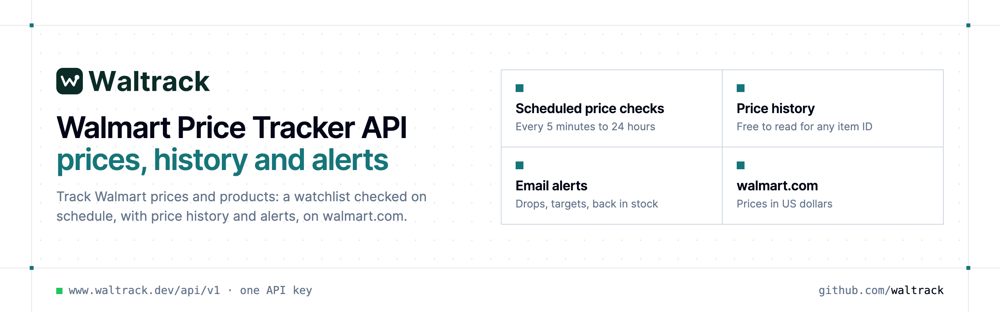

<p align="center">
  <a href="https://www.waltrack.dev"></a>
</p>

<p align="center">

[](https://www.waltrack.dev) [](https://www.waltrack.dev/signup) [](https://www.waltrack.dev/docs)

</p>

**Waltrack** tracks **Walmart prices and products**: add an item ID or a Walmart link to your watchlist, Waltrack checks it on schedule, keeps every check as price history and emails you when the price drops, reaches your target or the product is back in stock. Everything in the app is available through a REST API, an MCP server and a Chrome extension.

### Why Waltrack?

- **A watchlist that runs on its own** — each product is checked on schedule, from every 5 minutes to every 24 hours depending on the plan.
- **Price history for any item ID** — read every price Waltrack has seen, free and without tracking the product.
- **Alerts by email** — price drops, target prices and products back in stock.
- **Pay for what you check** — each price check costs 1 credit (about 30 credits a month for a product checked daily) and failed checks are refunded. Free for 50 products.
- **Use it your way** — the same API key works with the REST API, the MCP server and the Chrome extension.
- **Copy-paste examples** — Python and TypeScript in each README, 7 more languages in `examples/`.

```bash
curl -G https://www.waltrack.dev/api/v1/history \
  -H "Authorization: Bearer $WALTRACK_API_KEY" \
  --data-urlencode "item_id=17835006350"
```


### Repositories

- [**Walmart Price Alerts API**](https://github.com/waltrack/walmart-price-alerts-api) — Get an email when a Walmart price drops or reaches your target
- [**Walmart Price History API**](https://github.com/waltrack/walmart-price-history-api) — Every price Waltrack read for an item ID, with lowest, highest and average
- [**Walmart Price Tracker API**](https://github.com/waltrack/walmart-price-tracker-api) — A watchlist of Walmart products, checked on schedule
- [**Walmart Search API**](https://github.com/waltrack/walmart-search-api) — Find the item ID of any Walmart product by keyword

### Tools

[MCP server](https://www.waltrack.dev/api/mcp) · [Claude plugin](https://github.com/waltrack/waltrack-plugin) · [API docs](https://www.waltrack.dev/docs) · [OpenAPI](https://www.waltrack.dev/openapi.json)

---

📚 [API reference](https://www.waltrack.dev/docs) · 🔑 [Get your API key](https://www.waltrack.dev/signup) · 🌐 [www.waltrack.dev](https://www.waltrack.dev)
